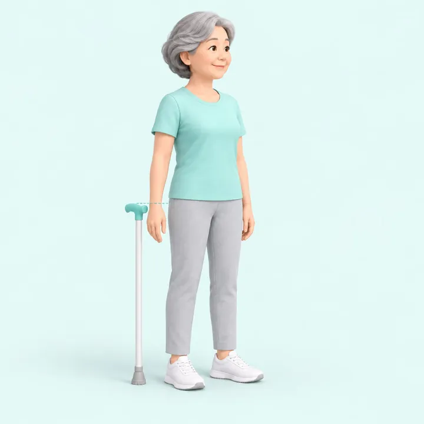
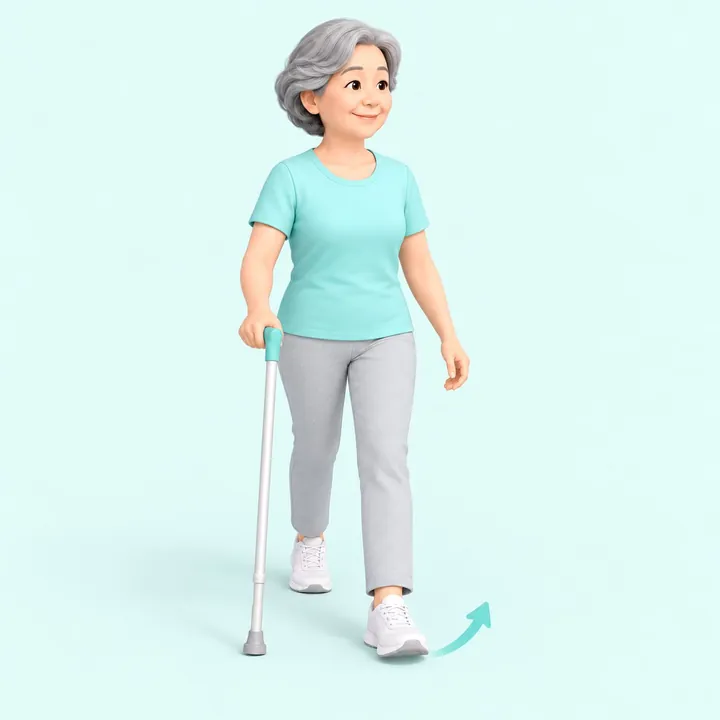

## เลือกไม้เท้าให้พอดีตัว

ยืนตรง ปล่อยแขนข้างลำตัว **ด้ามจับควรอยู่ระดับข้อมือ** เมื่อจับแล้วข้อศอกงอเล็กน้อยประมาณ 20-30 องศา

ถ้าไม้เท้าสูงหรือต่ำเกินไป จะปวดไหล่และทรงตัวได้ไม่ดี

## ถือข้างไหน

ถือ **ข้างที่แข็งแรง** เสมอ ตรงข้ามกับขาที่อ่อนแรง

## ลำดับการก้าว

1. ยื่นไม้เท้าไปข้างหน้า
2. ก้าวขาข้างที่อ่อนแรงตาม
3. ก้าวขาข้างที่แข็งแรงตามมา

ขึ้นบันได ให้ขาข้างแข็งแรงขึ้นก่อน ลงบันได ให้ไม้เท้าและขาข้างอ่อนแรงลงก่อน

## ตรวจอุปกรณ์ก่อนใช้ทุกครั้ง

- ยางกันลื่นที่ปลายไม้เท้า ไม่สึกจนเรียบ
- น็อตล็อกความสูง แน่นดี ไม่หลวม
- ด้ามจับไม่แตก ไม่ลื่น

## ทำบ้านให้ปลอดภัย

- เก็บสายไฟ พรมเช็ดเท้า ของวางพื้น ให้พ้นทางเดิน
- ติดราวจับในห้องน้ำ
- เปิดไฟให้สว่างพอ โดยเฉพาะทางเดินกลางคืน
- ใส่รองเท้าที่มีส้นหุ้ม พื้นกันลื่น ไม่ใส่รองเท้าแตะหลวม
